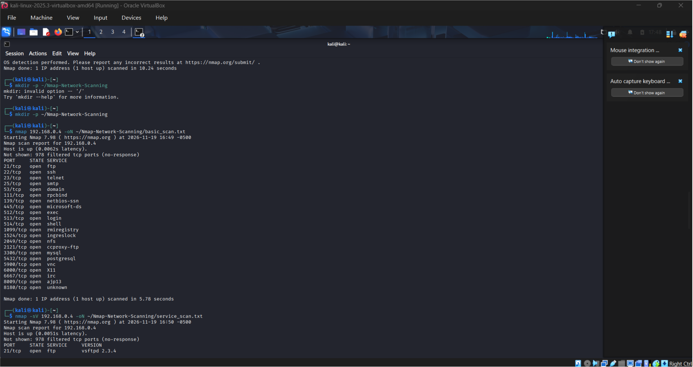
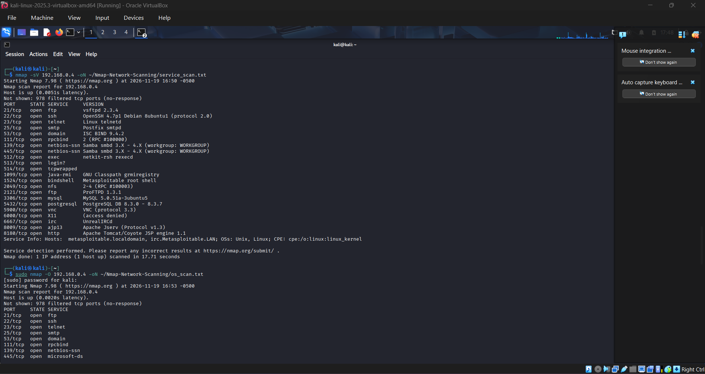
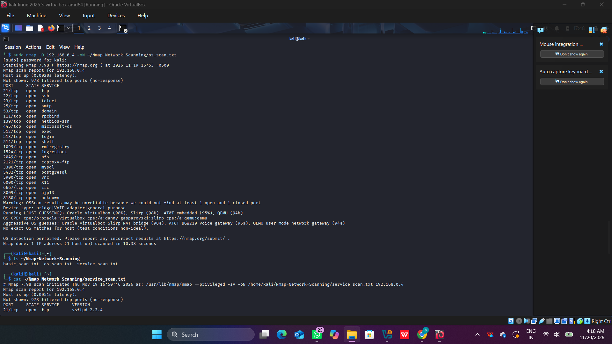
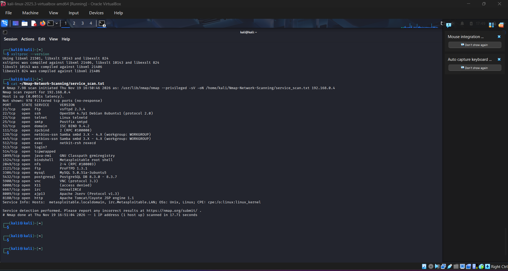
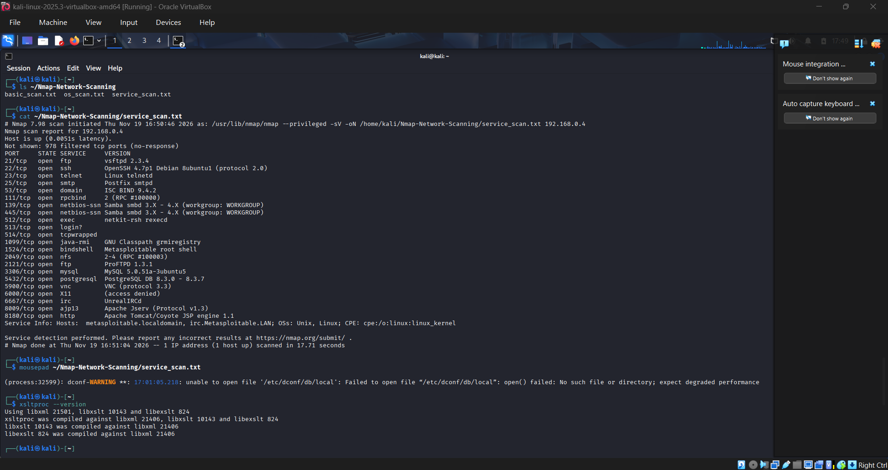

# Basic Network Scanning with Nmap

Task 1 (Beginner): scan a local VM with Nmap, find open ports and services, and analyse the risks.

## What is Nmap?

**Nmap (Network Mapper)** is a free, open-source tool for network discovery and security auditing. It shows:

- which hosts are up
- which ports are open
- which services and versions run
- which OS the target may use

## Why Network Scanning Matters

- **Find exposed services:** every open port is a possible entry point.
- **Spot outdated software:** version scans reveal vulnerable versions.
- **Visibility:** shows what is really running on a network.
- **Defence:** fix weaknesses before attackers find them.

## Lab Setup

| Item | Details |
|------|---------|
| Scanner | Kali Linux 2025.3 (VirtualBox) |
| Tool | Nmap 7.98 |
| Target | `192.168.0.4` (Metasploitable, Linux) |
| Network | Private local network only |

## Installation

Kali already includes Nmap. On Ubuntu/Debian:

```bash
sudo apt update
sudo apt install nmap -y
nmap --version
```

Windows: download from https://nmap.org/download.html

## Scans Performed

| Scan | Command |
|------|---------|
| Basic | `nmap 192.168.0.4` |
| Service version | `nmap -sV 192.168.0.4` |
| OS detection | `sudo nmap -O 192.168.0.4` |

Outputs were saved with `-oN`, e.g.:

```bash
nmap -sV 192.168.0.4 -oN service_scan.txt
```

## Results Summary

| Item | Result |
|------|--------|
| Host | Up |
| Open ports | 22 |
| Filtered ports | 978 |
| Target OS | Linux (Metasploitable) |

### Open Ports

| Port | Service | Version | Risk |
|------|---------|---------|------|
| 21 | FTP | vsftpd 2.3.4 | Critical |
| 22 | SSH | OpenSSH 4.7p1 | Medium |
| 23 | Telnet | Linux telnetd | High |
| 25 | SMTP | Postfix | Medium |
| 53 | DNS | BIND 9.4.2 | Medium-High |
| 111 | rpcbind | RPC 2 | Medium |
| 139 | NetBIOS | Samba 3.X-4.X | High |
| 445 | SMB | Samba 3.X-4.X | High |
| 512 | rexec | netkit-rsh | High |
| 513 | rlogin | login | High |
| 514 | rsh | tcpwrapped | High |
| 1099 | Java RMI | GNU Classpath | High |
| 1524 | Bindshell | root shell | Critical |
| 2049 | NFS | RPC 2-4 | High |
| 2121 | FTP | ProFTPD 1.3.1 | High |
| 3306 | MySQL | 5.0.51a | High |
| 5432 | PostgreSQL | 8.3.x | High |
| 5900 | VNC | protocol 3.3 | High |
| 6000 | X11 | access denied | Medium |
| 6667 | IRC | UnrealIRCd | Critical |
| 8009 | AJP13 | Apache Jserv | High |
| 8180 | HTTP | Tomcat | High |

Explanation of every port (what it does and why it is risky): see [`nmap_scan_results.txt`](nmap_scan_results.txt).

### Top Risks

| Port | Why |
|------|-----|
| 1524 | Open root shell, no password |
| 21 | vsftpd 2.3.4 has a known backdoor (CVE-2011-2523) |
| 6667 | UnrealIRCd backdoor in some releases (CVE-2010-2075) |
| 23 | Telnet sends passwords in plain text |
| 512-514 | Old r-services, unencrypted |

### OS Detection Note

Nmap guessed *Oracle VirtualBox / QEMU* with an "unreliable" warning. It detected the VirtualBox NAT layer, not the VM itself. The service scan shows the real target: **Metasploitable (Linux)**.

## Screenshots

**Basic scan**



**Service version scan**



**OS detection scan**



**Saved output**



**Saved scan files in the project folder**



## Repository Structure

```
OIBSIP/CyberSecurity-Task1-NmapNetworkScanning/
├── README.md
├── nmap_scan_results.txt
├── basic_scan.txt
├── service_scan.txt
├── os_scan.txt
└── screenshots/
```

## Ethical Use Guidelines

- Scan only machines you **own** or have **written permission** to test.
- Never scan external or production systems without authorization. It can be illegal.
- Practice on a local, isolated VM. All scans here were on a private lab VM.
- Do not use results to attack or disrupt systems.
- Report vulnerabilities responsibly.

## Disclaimer

For educational purposes only. Metasploitable is intentionally vulnerable and must never be exposed to the internet.
