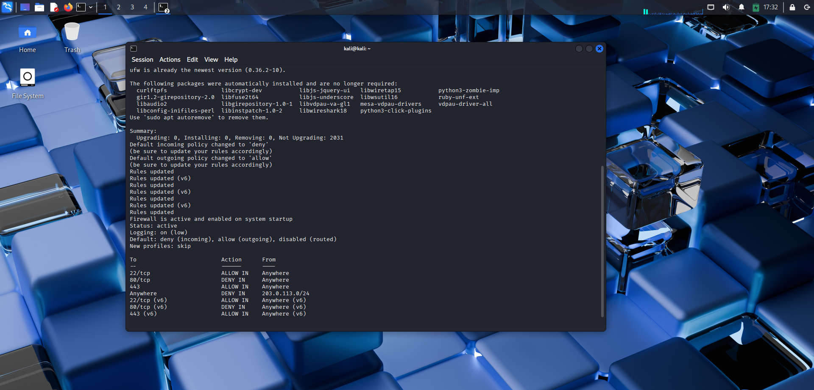
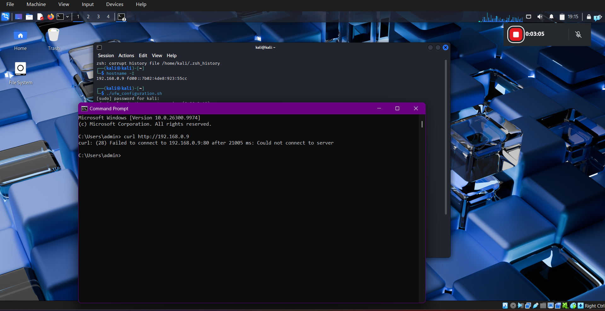
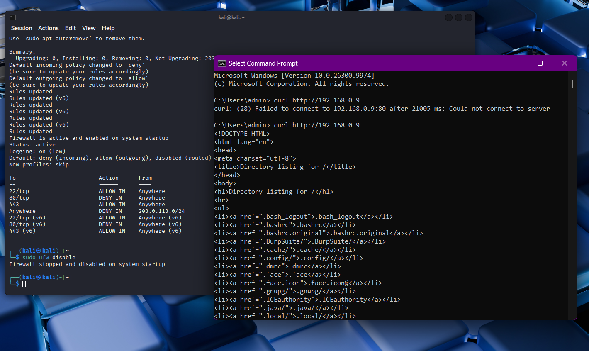

# Basic Firewall Configuration with UFW

## Objective
Set up and configure a basic firewall on a Linux system using UFW (Uncomplicated Firewall), applying rules to allow and deny specific types of traffic.

## Environment
- OS: Kali Linux (VirtualBox VM)
- Tools: UFW, Python 3 (for the test web server), curl

## What is a firewall?
A firewall is a security system that monitors network traffic and decides whether to allow or block it based on a set of rules. It acts as a barrier between a trusted system and untrusted networks, so only the traffic you explicitly permit can reach your machine. UFW is a simple front-end for the Linux firewall (iptables) that makes writing these rules easy.

## Files in this repository
| File | Description |
|------|-------------|
| `ufw_configuration.sh` | Runnable script that applies all rules in sequence |
| `README.md` | This document |
| Screenshots | Proof of active rules and of the traffic test |

## How to run
```bash
chmod +x ufw_configuration.sh
./ufw_configuration.sh
```

## Rules applied and why they were chosen
| Rule | What it does | Why it was chosen |
|------|--------------|-------------------|
| `ufw default deny incoming` | Blocks all incoming connections unless a rule allows them | Least-privilege principle: everything is blocked by default, so only what is needed is opened |
| `ufw default allow outgoing` | Allows the system to make outgoing connections | Lets updates, browsing and DNS work normally |
| `ufw allow ssh` (port 22) | Allows SSH traffic | Keeps remote administration possible, and prevents locking myself out when the firewall is enabled |
| `ufw deny http` (port 80) | Blocks HTTP traffic | HTTP is unencrypted, and a web server is not needed on this machine, so it reduces the attack surface |
| `ufw allow https` (port 443) | Allows HTTPS traffic | Encrypted web traffic is safe to allow, and it is needed for secure browsing |
| `ufw deny from 203.0.113.0/24` | Blocks all traffic from this IP range | Demonstrates blacklisting a specific network (a documentation-reserved range used here as an example) |

The firewall is enabled **after** the SSH rule is added, so the SSH connection is never cut off.

## Verifying the rules
```bash
sudo ufw status verbose
```
This shows the firewall status, default policies, logging level and all active rules.

Output of the script, ending with the active rules (`ufw status verbose`):



## Testing that denied traffic is blocked
**Method:**
1. On the Kali VM, found the IP address with `hostname -I`.
2. Started a test web server on port 80:
   ```bash
   sudo python3 -m http.server 80
   ```
3. From the host machine, tried to reach the server:
   ```bash
   curl http://<VM-IP>
   ```
4. **Result (firewall enabled):** The request hung and failed with `Could not connect to server` after about 21 seconds, which confirms that the firewall is blocking port 80 (HTTP).
5. **Control test (firewall disabled):** After running `sudo ufw disable` on the VM, the same `curl` command returned the server's directory listing. This proves that the earlier failure was caused by the firewall and not by the server being down.

Testing was done from the host machine, because a machine can always reach its own services and a test from inside the VM would not prove anything.

Firewall enabled, `curl` from the host is blocked:



Rules active on the VM, then firewall disabled, and the same `curl` succeeds:



## Recording
Screen recording of the full process: (add link here)

## Cleanup
After the task, the firewall was reset to its original state:
```bash
sudo ufw disable
sudo ufw reset
```

## Conclusion
A default-deny policy with only the necessary services allowed (SSH, HTTPS) gives a simple but strong baseline for securing a Linux system. Blocking HTTP and a specific IP range showed how individual rules can be used to reduce exposure further.

## References
- Ubuntu UFW documentation: https://help.ubuntu.com/community/UFW
